# Architecture

This page describes ZFSutilities with the C4 model. The model shows a software
system as nested zoom levels: the system in its environment, the runnable
pieces inside it, the building blocks inside those pieces, and where
everything runs. The page is organized along those levels:

- **System context** — who uses ZFSutilities and which neighboring systems it
  touches.
- **Containers** — the runnable programs and data stores inside the product
  boundary. This is the C4 term, not Docker/LXC; nothing in ZFSutilities
  runs in a system container.
- **Components** — the major building blocks inside the bash library and the
  Python application.
- **Bash runtime foundation** — how bash code initializes, logs, and reads
  parameters.
- **Data and configuration** — the persistent data shapes and rules.
- **Runtime flows** — what a backup, restore, and offsite run actually do.
- **Deployment** — versioned installs and the two-node iSCSI arrangement.
- **Resilience** — how failures are contained and recovered.

## System Context

This view answers two questions: who uses ZFSutilities, and which external
systems does it talk to? Everything inside the product is a single box at
this level.

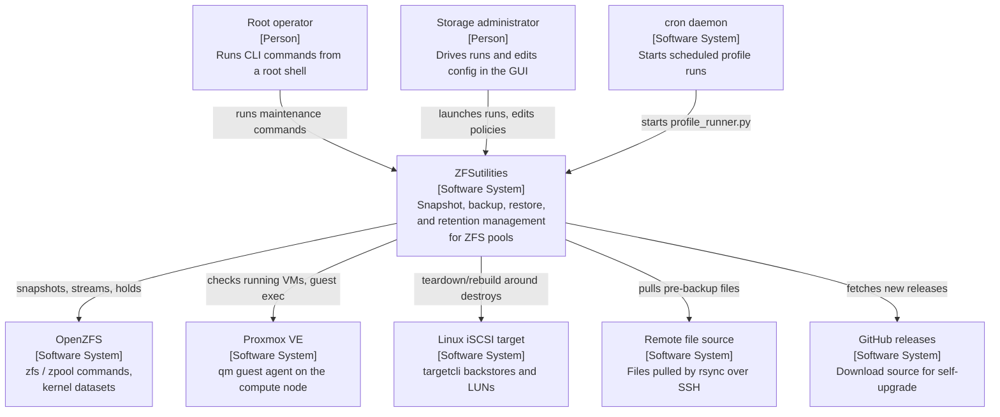

- **Root operator** — runs backups, restores, retention, pool and VM
  maintenance, and upgrades from a root shell.
- **Storage administrator** — drives interactive runs and edits pools,
  retention policies, and the checkagainst table from the GTK GUI.
- **cron daemon** — starts scheduled, headless profile runs.
- **OpenZFS** — every snapshot, send, receive, hold, and pool operation goes
  through the `zfs` and `zpool` command line.
- **Proxmox VE** — running-VM checks and guest commands on the compute node
  via `qm guest`.
- **Linux iSCSI target** — zvol backstores and LUNs torn down and rebuilt
  around destructive operations in two-node mode.
- **Remote file source** — pre-backup files pulled by `rsync-dailybackup`
  over SSH.
- **GitHub releases** — the download source for `upgrade-zfsutilities`.

## Containers

This view answers: which independently runnable pieces and data stores make
up ZFSutilities, and how do they talk? The people, cron, and OpenZFS from the
context view appear again for continuity.

"Container" is the C4 model's word for a separately runnable program or a
data store. It never means Docker, LXC, or any other system container
here — nothing in ZFSutilities runs in one.

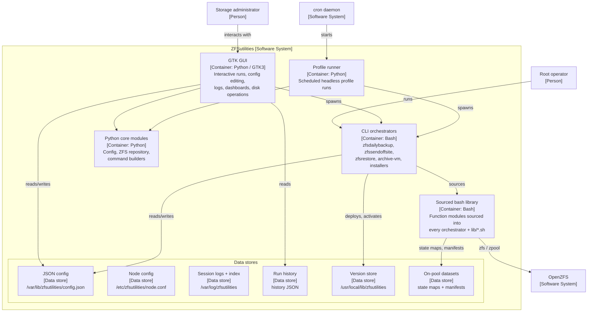

Containers:

- **GTK GUI** — a Python/GTK3 desktop application. Interactive runs, config
  editing, logs, dashboards, and disk operations.
- **Profile runner** — `profile_runner.py`, a separate Python entry point
  that cron starts for scheduled headless runs.
- **CLI orchestrators** — the bash commands a human or the GUI runs:
  `zfsdailybackup`, `zfssendoffsite`, `zfsrestore`, `archive-vm`, the
  installers, and the maintenance commands.
- **Sourced bash library** — function modules sourced into every
  orchestrator, plus the `lib/*.sh` helpers. It never runs standalone; it
  runs inside each command's process.
- **Python core modules** — config access, the ZFS repository wrapper, and
  command builders, shared by the GUI and the profile runner.

Data stores:

- **JSON config** — `/var/lib/zfsutilities/config.json`: pools, retention,
  checkagainst table, GUI state.
- **Node config** — `/etc/zfsutilities/node.conf`: node role and iSCSI
  targets in two-node mode.
- **Session logs + index** — `/var/log/zfsutilities`: one log per run plus
  the Logs-tab index.
- **Run history** — per-run history JSON read by the Dashboard.
- **Version store** — `/usr/local/lib/zfsutilities/versions` plus the
  `current` symlink.
- **On-pool datasets** — `*/zfsutilities` state maps and
  `*/zfsutilities-manifests` riding the backup chain.

The GUI never reimplements ZFS logic. Both Python programs orchestrate the
same bash commands; see
[GUI ↔ Bash Integration Architecture](#gui-bash-integration-architecture).

## Components

This level zooms into two of those programs: the sourced bash library and the
Python application. The remaining sections of this page detail the same
building blocks, so each diagram stays a map, not a duplicate.

The bash library decomposes into these components:

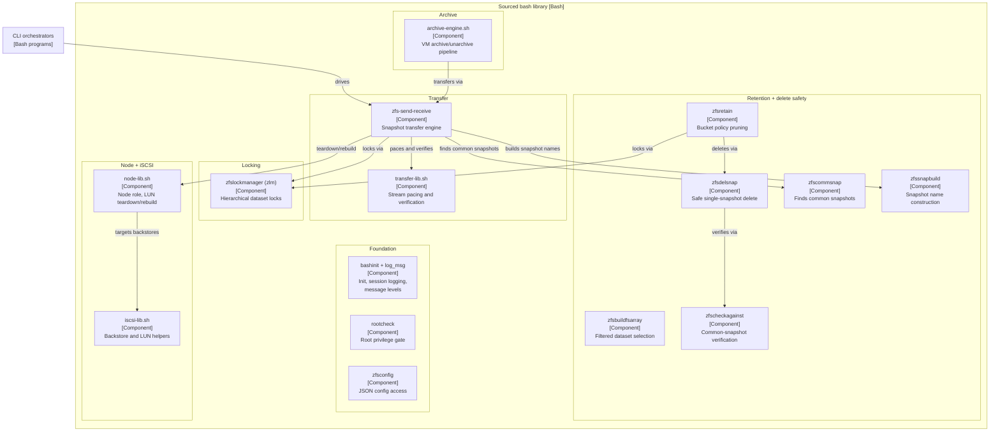

Every command initializes through the foundation cluster before any work
starts. The five components with the deepest documentation are described in
[Core Components](#core-components) below; every module has a reference page
in [Modules](../commands-and-modules/modules.md).

### Core Components

#### [zfs-send-receive](../commands-and-modules/modules.md#zfs-send-receive)

The main workhorse. Key parameters (all global variables):

| Variable           | Type    | Purpose                                                  |
| ------------------ | ------- | -------------------------------------------------------- |
| `$sourcefs`        | string  | Source dataset                                           |
| `$destfs`          | string  | Destination pool/dataset                                 |
| `$doincrementals`  | `Y`/`N` | Attempt incremental transfers                            |
| `$dointermediates` | `Y`/`N` | Include intermediate snapshots                           |
| `$includes`        | array   | Dataset name substrings to include                       |
| `$excludes`        | array   | Dataset name substrings to exclude                       |
| `$autoproceed`     | `Y`/`N` | Suppress interactive prompts                             |
| `$nextsnap`        | string  | Snapshot name to create                                  |
| `$force`           | `Y`/`N` | Force a full copy even if an incremental copy would work |

#### [zfsbuildfsarray](../commands-and-modules/modules.md#zfsbuildfsarray)

Builds a filtered list of datasets into `$fsarray`. Respects:

- `$depth` — limit recursion depth. "0" means only the dataset itself. Null means unlimited.
- `$bottomup` — `'Y'` for descending sort
- `$includes` — array of dataset substrings to include (prefix `"="` for exact match from the beginning of the dataset name). If specified, only the matching dataset names are included. If not specified, all otherwise qualified datasets are included.
- `$excludes` — array of dataset substrings to exclude (prefix `"="` for exact match from the beginning of the dataset name). If not specified, no otherwise qualified datasets are excluded.
- `$startwith` — skip datasets before this substring match. If no otherwise qualified datasets are found, the script will abort.
- `$endwith` — skip datasets after this substring match. If no otherwise qualified datasets are found, the script will abort.

The parameters are processed in the order given above.

#### [zfsretain](../commands-and-modules/modules.md#zfsretain)

Applies retention policies in three phases:

1. For `@offsite` snapshots, remove all but the most recent per month per dataset
2. Remove same-day duplicate snapshots within each bucket
3. Prune by bucket retention counts ("policies")

Snapshots with label `clone` or bucket `c` are skipped entirely—they are never deleted, compared, or placed into bucket arrays. Clone-origin snapshots cannot be deleted while dependent clones exist.

Calls [zfsdelsnap](../commands-and-modules/modules.md#zfsdelsnap) for each deletion, which runs safety checks.

#### [zfsdelsnap](../commands-and-modules/modules.md#zfsdelsnap)

Deletes a single snapshot after:

1. Releasing holds (if `$releaseholds='Y'`)
2. Verifying via [zfscheckagainst](../commands-and-modules/modules.md#zfscheckagainst) that it's safe to delete

#### [zfscheckagainst](../commands-and-modules/modules.md#zfscheckagainst)

Verifies a snapshot is not the last common snapshot shared with a counterpart
dataset. Maintains a lookup table (`fss` table, configured by the GUI Checkagainst tab) mapping dataset pairs and labels.

When a counterpart pool is offline (offsite label only), uses hold-tag
verification: scans other `@offsite` snapshots on the same source dataset for a
hold named `offsite-<counterpart_pool>`. If another snapshot has the hold, the
counterpart received it too — a second common snapshot is confirmed and deletion is safe. If no other snapshot has the hold, deletion is blocked until the pool comes online. Non-offsite labels always block when offline (no holds to check).

The fss table lives in the shared JSON config at `/var/lib/zfsutilities/config.json`
under the [zfscheckagainst](../commands-and-modules/modules.md#zfscheckagainst) key, accessed from bash via `zfsconfig_get_checkagainst`
(see [`zfsconfig`](../commands-and-modules/modules.md#zfsconfig)) and from the GUI via `feature_config.get_checkagainst`. Each row stores a
`source_root`, `dest_root`, `label`, and optional `comment`. The counterpart
dataset for a snapshot is constructed by replacing the snapshot's
`source_root` prefix with the `dest_root` prefix.

A `<offsite>` placeholder in either root is resolved at check-time to **all**
pools marked as offsite candidates in the pool registry. The snapshot is safe
to delete if any online candidate has a counterpart snapshot, or (for
`offsite` labels) if hold-tag verification succeeds for an offline candidate.
If no candidate verifies, deletion is blocked.

Returns:

| Code | Meaning                                                       |
| ---- | ------------------------------------------------------------- |
| 0    | Safe to delete (includes hold-verified offline counterpart)   |
| 4    | No counterpart snapshots found — candidate is not common      |
| 5    | No entry in the fss table — no check performed                |
| 6    | Counterpart pool offline and no hold tag — blocked for safety |
| 7    | Last remaining common snapshot — deletion blocked             |
| 8    | Fatal error                                                   |

### GUI ↔ Bash Integration Architecture

The GTK GUI (`python/`) does not reimplement ZFS logic in Python. Instead, it **orchestrates** the same bash scripts used on the command line. Two Python runners handle this:

- **`BackupRunner`** (`backup_runner.py`) — used by the GUI for interactive Backup, Offsite, Restore, and Retention tabs.
- **`profile_runner.py`** — used by cron for scheduled, headless execution.

Both runners share the same architectural contract with bash:

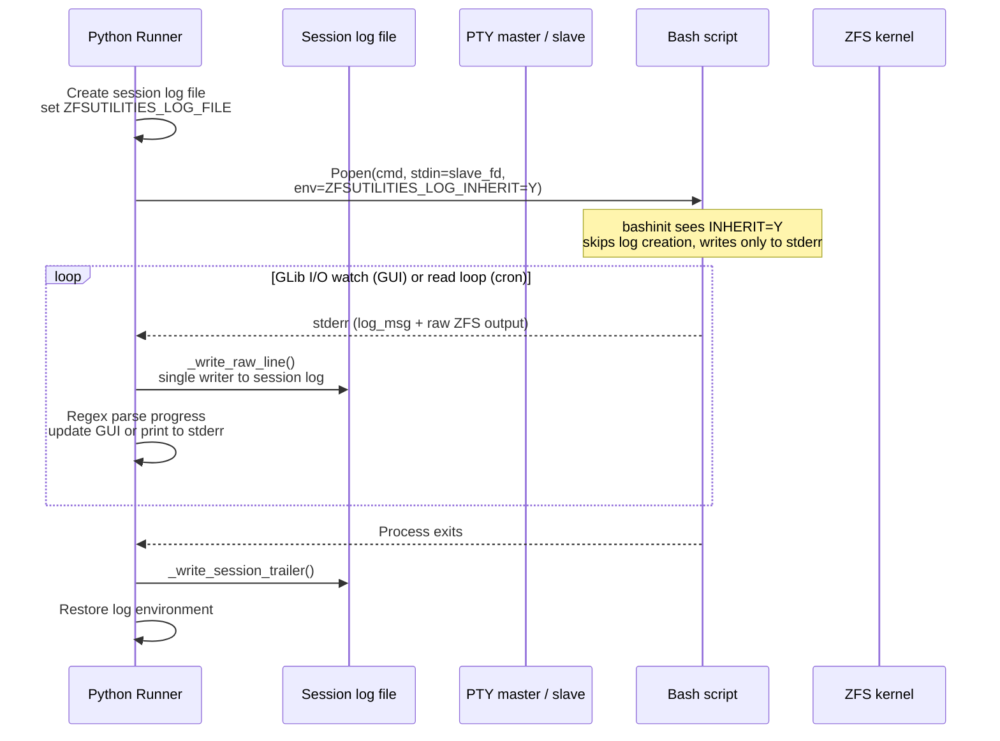

#### Single-writer session log

`ZFSUTILITIES_LOG_INHERIT=Y` is the critical switch. When present in a subprocess's environment, `bashinit` does **not** create its own session log; instead, bash `log_msg` writes only to stderr. The Python runner reads stderr (and stdout) from the subprocess pipe and appends every line to the session log file with a timestamp prefix. This guarantees:

1. **No duplicate lines** — Both bash and Python log output appear exactly once.
2. **Raw output preserved** — `zfs receive` progress lines and separator lines are written to the session log even though they are not `log_msg` calls. `pv` rate output is captured for the GUI status bar but is not written to the session log.
3. **Atomic finish** — The runner writes a `# END: rc=..., duration=...s` trailer after the subprocess terminates.

For cron launches the job line additionally sets `ZFSUTILITIES_FROM_CRON=Y`.
Once the session log exists, `profile_runner.py` fences the runner's own
output streams for the rest of the run, so the weekly cron log holds only the
failures that precede the session log. An unhandled runner crash is caught at
the top of the run; its traceback and a failed trailer land in the session
log. Run Now and manual terminal launches are not fenced.

Cron terminates a job's command at the first unescaped `%` and feeds the
remainder to the job's stdin (crontab(5)), so `generate_cron_line()`
backslash-escapes every `%` in the command portion it builds; a pre-escaped
`\%` is left alone. Cron strips the backslash before the shell sees the
command, so the executed pipeline is unchanged. Cron launches also append two
breadcrumb lines directly to the cron log — `Scheduled run started (cron)`
when the runner starts and `Scheduled run finished (cron) ... rc=N` on exit —
so a schedule that stops firing shows up as missing breadcrumbs instead of an
empty log.

A cron line that redirects its output straight into the cron log is treated
as a cron launch and fenced the same way. The drop-ins are persisted `/etc`
state: `cron_manager.converge_scheduler_files()` re-derives their content at
GUI startup and at the start of every run, rewriting each only when it
differs. Missing drop-ins are created only when active profiles exist, so a
host with no schedules gains none.

#### Progress parsing

`BackupRunner` uses two regexes to extract live transfer metrics from stdout and
stderr:

- **`_PV_RATE_RE`** — Defined in `command_builders.py`; matches `pv` progress output like `[28.1MiB/s]`. The match text is captured for the GUI progress indicator.
- **`_ZFS_RECEIVED_RE`** — Matches the final `zfs receive` summary line (`received 1.23GiB stream in 45.67 seconds`, plus bare suffix forms such as `received 319M stream in 8.46 seconds`). The captured byte count is accumulated across all datasets and written into the history JSON. It is checked both during live I/O watches and in the final `_drain_remaining()` pass so bytes are not lost if the line arrives after the process exits.

`profile_runner.py` uses the same `_ZFS_RECEIVED_RE` regex when scanning the session log after completion to compute total bytes transferred.

#### Python GUI architecture

The Python layer in `python/` is organized into focused modules behind the
same bash orchestration contract. The component view shows the module groups;
the table below lists the individual modules.

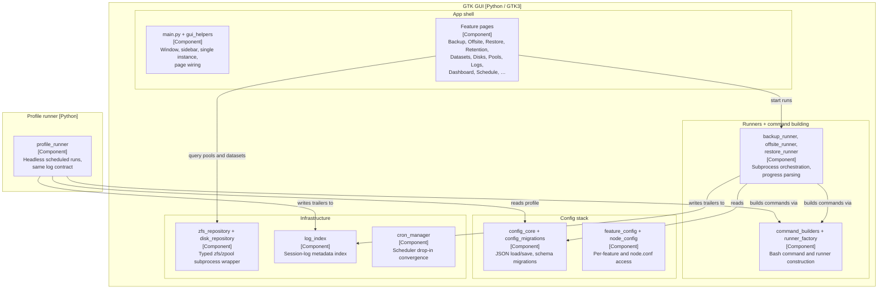

| Module | Responsibility |
| ------ | -------------- |
| `app_context.py` | `AppContext` dataclass — cross-cutting, non-GTK state (config, script/parent dirs, version, `ZfsRepository`). Pages receive this instead of treating the GTK window as a generic state bucket. |
| `config_core.py` | Core JSON config: `load_config`/`save_config`, path helpers, UI state, log/history retention, dashboard config. |
| `feature_config.py` | Per-feature getters/setters: backup, offsite, restore, retention, pools, checkagainst, snapshot names, scrub manager — plus the managed-pool scope helpers (`get_managed_pool_names`, `non_managed_pool_names`, endpoint parsing) that gate every GUI pool list, save, and run. |
| `logging_config.py` | `log_msg`, message levels, GUI sink, `session_log_context()`. |
| `runner_factory.py` | Creates `BackupRunner` instances with shared GUI callbacks; keeps runner ownership out of `gui_helpers.py`. |
| `zfs_repository.py` | Repository pattern wrapper for all direct `zfs`/`zpool` subprocess calls; returns typed dataclasses (`PoolRow`, `DatasetRow`, `SnapshotRow`, `HoldRow`). |
| `pool_create.py` | Pure create-pool logic: disk eligibility, pool-name validation, ashift suggestion, width-aware RAIDZ capacity estimator, profile→`-O` option mapping. No GTK, no subprocess. |
| `pool_create_wizard.py` | GTK create-pool wizard (Disks page): four-step modal dialog with exact-command review and typed confirmation; executes via the Dataset action runner under a pool-name `zlm` write lock and offers to register the new pool in the pool registry. |
| `pool_growth.py` | Pure pool-growth policy: attach/replace/detach target classification, infra-vdev validation, scrub-block check. No GTK; the only live-state reader takes the repository as a parameter. |
| `pool_growth_dialogs.py` | GTK dialogs and Disks-page handlers for the five pool-growth operations; shared review scaffold (exact command, warnings, confirmation matched to the danger); executes via the Dataset action runner under a pool-scope `zlm` write lock. |
| `command_builders.py` | Builds bash commands and returns `BashStep` dataclasses instead of loose tuples. |

`backup_config.py` re-exports the public API of `config_core.py`,
`feature_config.py`, and `logging_config.py` for compatibility.

## Bash runtime foundation

Every bash command boots through the same pattern and logs through the
same machinery. These sections describe that shared foundation.

### Script Sourcing Pattern

All bash scripts follow this initialization pattern:

```bash
_local_bashinit=$(dirname "$(realpath "${BASH_SOURCE[0]}")")/bashinit
if [[ -f "$_local_bashinit" ]]; then
    source "$_local_bashinit"
else
    source ~/bashinit
fi
bashinit
unset _local_bashinit

source_helper rootcheck
rootcheck
```

- Scripts prefer the `bashinit` next to them so a repository checkout or
  deployed version bootstraps itself with matching helpers; the fallback to
  `~/bashinit` supports test layouts that provide only a fake `bashinit` in
  `$HOME`.
- `bashinit` sets `$mydir` to the calling script's directory and provides `source_helper`, which resolves siblings via `find_zfsutility_script`
- [rootcheck](../commands-and-modules/modules.md#rootcheck) verifies the script is running as root
- Function scripts are **sourced**, not executed — their functions persist in the
  calling shell's environment

Because scripts are sourced, **any global variables set inside them persist**
after the function returns. This is intentional: it allows caller scripts to
read output variables like `fsarray` (the list of datasets built by
[`zfsbuildfsarray`](../commands-and-modules/modules.md#zfsbuildfsarray)).

#### Session logging

`bashinit` auto-creates a session log file for scripts that are executed
directly (`calledbybash` returns true). It generates a filename like
`YYYY-MM-DD_HH-MM-SS_cli_<scriptname>.log` in
`/var/log/zfsutilities/sessions/` and exports it as
`ZFSUTILITIES_LOG_FILE` when the file can be created (a non-root user
cannot write the root-owned session directory, so messages go to stderr
only). Bash `log_msg` appends to this file when the
variable is set.

Both the GTK GUI (`BackupRunner`) and scheduled cron runs
(`profile_runner.py`) create a session log file and act as the **single writer**
for that log. Bash subprocesses receive `ZFSUTILITIES_LOG_INHERIT=Y` via their
environment. `bashinit` sees that flag and skips creating its own session log,
writing only to stderr. The Python runner reads raw stdout/stderr from the
subprocess pipes and writes every line to the session log file with a timestamp
prefix. This prevents duplicate lines and ensures that raw output (dataset
lists, `zfs receive` progress, separator lines, etc.) is preserved alongside
`log_msg` output.

Cron launches fence the runner's own output streams onto `/dev/null` once the
session log exists, so the weekly cron log receives only the failures that
precede the session log. A cron line that redirects straight into the cron log
is fenced the same way. The cron/logrotate drop-ins are persisted `/etc` state:
`cron_manager.converge_scheduler_files()` re-derives their content at GUI
startup and at the start of every run, rewriting a file only when it differs.

After a run finishes, is cancelled, or aborts with rc=9, the runner discards
its session-log state so the next operation starts a fresh log file.

| Context                  | Auto-set? | Notes                                                                                                                                              |
| ------------------------ | --------- | -------------------------------------------------------------------------------------------------------------------------------------------------- |
| Direct CLI execution     | **Yes**   | `bashinit` creates the log and exports the variable                                                                                                |
| GUI runs                 | **Yes**   | `BackupRunner.prepare_session_log()` creates the log; `ZFSUTILITIES_LOG_INHERIT=Y` prevents bash subprocesses from creating competing logs         |
| Scheduled cron runs      | **Yes**   | `profile_runner.py` creates the log and sets `os.environ` before dispatching                                                                       |
| Sourced function scripts | **No**    | They inherit the variable from the parent script that sourced them                                                                                 |

If you need to capture output from a manually-run bash command, set the
variable yourself before invoking the script:

```bash
export ZFSUTILITIES_LOG_FILE="/var/log/zfsutilities/sessions/manual.log"
./zfs-send-receive
```

#### Terminal message-level gate

`log_msg` writes every message to the terminal by default. A script that
drives other scripts can set `ZFSUTILITIES_MSG_LEVEL` so its children show
only messages at or above one level (`DEBUG`, `VERB`, `INFO`, `WARN`,
`FATAL`). The gate has three properties:

- It filters terminal (stderr) output only. The session log and the GUI log
  sink still receive every message.
- A message without a `LEVEL:` prefix always passes, matching the log viewers.
- An unset or unrecognized value gates nothing.

Bash and Python `log_msg` apply the same rule. In bash,
`with_msg_level <LEVEL> <command...>` scopes the gate to one call and restores
the caller's value afterward. The helper runs the command in the current
shell, so shell state and exit traps stay with the caller. Its single-message
mirror is `log_verb <text...>`: the message is logged at `VERB` level, so it
stays off the terminal unless the operator's gate allows `VERB`, while the
session log keeps it either way.

`archive-vm` sets the gate to `WARN` for the archive engine calls. An archive
run therefore narrates its own steps, and the engine speaks only when
something is wrong. A message that must survive a driven gate lifts the gate
for one call (`ZFSUTILITIES_MSG_LEVEL='' log_msg ...`); the engine does this
for the `Enclosure rate cap applied` notice.

#### Session log size cap

To prevent a runaway subprocess from filling disk, the Python runners enforce a
configurable size cap on the session log file they own. The maximum is stored in
`/var/lib/zfsutilities/config.json` under `session_log_max_bytes` and defaults to
**10 MB**. When a log grows beyond the configured maximum, it is rewritten as:

- the first **64 KB** (opening context),
- a marker line indicating how many bytes were omitted,
- the last **1 MB** (recent tail).

Use `config_core.get_session_log_max_bytes()` and
`config_core.save_session_log_max_bytes()` to read or change the cap.

`backup_runner.py` checks the file size every 5 seconds via its process polling
timer; `profile_runner.py` checks every 5 seconds while reading subprocess
output and once more after the profile finishes. Because inherited bash
subprocesses write to the same file, the cap also bounds their output. After
truncation, the persistent index entry for that log is removed so the Logs tab
rescans the smaller file.

The Logs tab's live viewer also limits the in-memory text buffer to the most
recent **2 MB** of characters while tailing a running log, dropping older
content to prevent unbounded RAM growth.

#### Persistent log index

The Logs tab uses `python/log_index.py` to avoid re-reading every
past session log on startup or refresh. The index is a JSON file at
`/var/log/zfsutilities/sessions/.log_index.json` that stores, per log file:

| Field               | Purpose                                                            |
| ------------------- | ------------------------------------------------------------------ |
| `size`              | Last-known file size in bytes                                      |
| `mtime`             | Last-known modification time                                       |
| `status`            | `Done`, `Failed`, `Cancelled`, or `Running` from the trailer       |
| `duration`          | Elapsed seconds from the trailer                                   |
| `bytes_transferred` | Bytes transferred from the trailer (ZFS send/receive steps)        |
| `highest_level`     | Highest `log_msg` level seen (`DEBUG`, `VERB`, `INFO`, `WARN`, `FATAL`) |
| `has_trailer`       | Whether the trailer has been parsed                                |

`BackupRunner._write_session_trailer()` and `profile_runner._write_session_trailer()`
update the index with the final status, duration, and bytes after writing the
trailer. `logs_page._scan_logs()` creates or incrementally updates entries for
any log without an up-to-date index record, removes entries for deleted files,
and saves the index. `logs_page._tail_log_file()` also updates the index
incrementally while a running log is being viewed.

When a log file contains more than one `# END` trailer (for example because the
file was reused or appended), `log_index.py` uses the **last** trailer and the
highest message level seen anywhere in the scanned text as the authoritative
metadata. This ensures the Logs tab reports the status, duration, and transfer
bytes of the final run rather than an earlier one.

The index is advisory: if it is missing or corrupt, the Logs tab falls back to
scanning the log files directly and rebuilds the index.

The index is persisted only when an entry actually changed: `update()` and
`set_status()` compare the recomputed entry against a pre-update snapshot and
leave the index clean when nothing differs. This matters because the index file
lives in the sessions directory, which `create_logs_page()` watches with a
`Gio.FileMonitor` so new session logs appear without a manual refresh. The
monitor ignores events for hidden files (the index, its atomic-rename temp
files, and lock files are all dotfiles), so the GUI's own index writes never
trigger a rescan — without both safeguards the monitor/rescan/save cycle feeds
back on itself and rewrites the index file continuously while the GUI sits
idle.

### Parameter Override System

[zfsoverrides](../commands-and-modules/modules.md#zfsoverrides) enables runtime parameter changes via command line argument:

```bash
sudo ./zfsdailybackup 'backup_NVME1=N; prune=N'
```

The argument is a semicolon-separated list of bash assignments that are
`eval`'d by the overrides function. See the command documentation or script source to determine which positional parameter accepts the override.

## Data and configuration

ZFSutilities keeps its state in a handful of persistent files and
follows fixed naming rules. These sections describe each one.

### Configuration System Layers

ZFS Utilities reads configuration from several layers. Higher layers override or shadow lower ones.

```
┌─────────────────────────────────────────────┐
│  Environment overrides                      │
│  ZFSCONFIG_PATH, ZFSCONFIG_LEGACY_DIR       │
├─────────────────────────────────────────────┤
│  JSON config                                │
│  /var/lib/zfsutilities/config.json            │
│  • pools, retention, checkagainst           │
│  • backup/offsite/restore GUI tab state     │
│  • config_version (schema migrations)       │
├─────────────────────────────────────────────┤
│  Node configuration                         │
│  /etc/zfsutilities/node.conf                │
│  • NODE_MODE, STORAGE_HOST, COMPUTE_HOST    │
│  • POOL_TARGET (iSCSI map)                  │
├─────────────────────────────────────────────┤
│  Legacy files (imported once, then ignored) │
│  zfscheckagainst.conf, zfsretainpol-*       │
└─────────────────────────────────────────────┘
```

#### JSON config migrations

The `config_version` field in the JSON file tracks schema evolution independently of the software release version. When `config_core.load_config()` detects an older version, it runs the migration chain (`v1 → v2 → … → v15`). Each migration is a pure Python function that mutates the dict and bumps the version. See [Data Structures — Config migrations](data-structures.md#config-migrations) for how to add a new migration.

### Snapshot Naming

Format: `@<label>-<yyyy-mm-dd>T<hh:mm>Z-<bucket>` (UTC, "Zulu"; legacy names
carry a local UTC offset instead — both forms parse)

Examples:

- `@dailybackup-2026-02-21T07:00Z-d`
- `@offsite-2026-02-21T15:00Z-s`

Built by [zfssnapbuild](../commands-and-modules/modules.md#zfssnapbuild). The label becomes the first field split on `-`;
the bucket is the last field split on `-`.

Labels are generally meant to allow the user to add information to the snapshot name. However, there are a few that are reserved and generally should not be used by the user.

The date and time are determined when 'zfssnapbuild' is executed. A snapshot's internal creation date/time will be different, depending on when the snapshot command was actually executed. ZFS does not use the date or time given in the snapshot name.

| Reserved Labels |                                                                                                                                       |
| --------------- | ------------------------------------------------------------------------------------------------------------------------------------- |
| @dailybackup    | The snapshot was created by [zfsdailybackup](../commands-and-modules/commands.md#zfsdailybackup)                                      |
| @offsite        | The snapshot was created by [zfssendoffsite](../commands-and-modules/commands.md#zfssendoffsite)                                      |
| @clone          | The snapshot is/was the parent of a clone ZFS dataset. This is not authoritative, and ZFS snapshot properties should also be checked. |

### Retention Policies

Per-pool retention policies live in the shared JSON config at
`/var/lib/zfsutilities/config.json` under the `retention` key, alongside the pool
list, checkagainst table, and
GUI tab state. Each pool has a list of bucket dicts:

```json
"retention": {
  "default": [
    {"name": "d", "retain": 3, "minage": 0},
    {"name": "w", "retain": 2, "minage": 0},
    {"name": "m", "retain": 2, "minage": 0},
    {"name": "s", "retain": 4, "minage": 65}
  ],
  "threeamigos": [ ... ]
}
```

[zfsretain](../commands-and-modules/modules.md#zfsretain) reads policies via `zfsconfig_get_retention <pool>`, which emits a
sourceable bash fragment (`bktname[i]='...'; bktretain[i]=N; minage[i]=N`).
Pool lookups fall back to the `default` entry. The GTK GUI's Retention tab
edits policies via `feature_config.get_retention` / `save_retention`.

## Runtime flows

These sections walk one run of each kind: the nightly backup, the
per-dataset transfer decision, a restore, and an offsite chain.

### Data Flow: Daily Backup

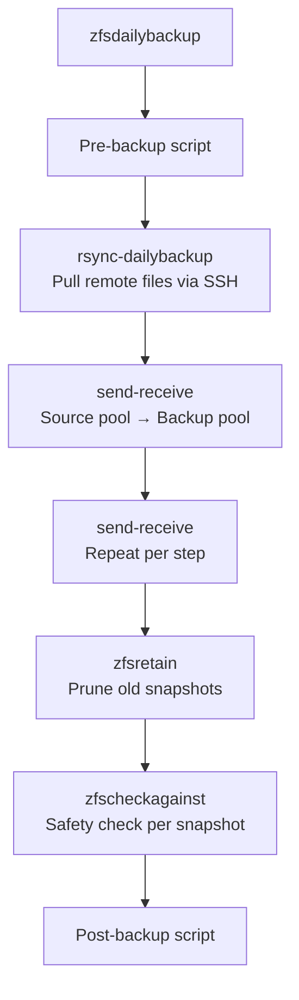

### Send/Receive Decision Flow

[`zfs-send-receive`](../commands-and-modules/modules.md#zfs-send-receive) is the engine that moves data. The diagram below shows the full decision tree for a single dataset inside the per-dataset loop. Details such as exact `zfs` flags and rollback prompts are omitted for clarity; see the script source and [Global Variables](global-variables.md) for the full parameter map.

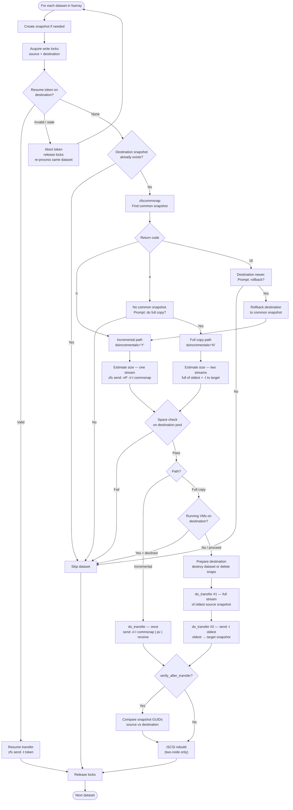

Key branches:

- **Resume token** — If a previous receive was interrupted, ZFS leaves a `receive_resume_token` on the destination. When `$autoresume='Y'`, the script validates the token with `zfs send -nP -t`, extracts the remaining byte count, and resumes mid-stream. If the token is stale, it is aborted (`zfs receive -A`), locks are released, the loop counter is decremented (`((i--))`), and the same dataset is re-evaluated from the top on the next iteration.
- **Common snapshot missing (rc=4)** — No shared snapshot exists between source and destination. The user is prompted for a full copy. If accepted, `$doincrementals` is set to `'N'`; if declined, the dataset is skipped.
- **Destination newer (rc=16)** — The destination has snapshots newer than the common one. The user is prompted to roll back; if accepted, intervening snapshots are destroyed and the common snapshot is rolled back to. After rollback, the transfer continues on the **incremental** path (`$doincrementals='Y'`).
- **Space check** — Before any transfer, `check_space_available` compares the dry-run size against destination pool free space plus a 10 % margin (minimum 1 GB). If space is insufficient, the user may skip or proceed anyway.
- **Running VMs** — Guards destination preparation, so it runs wherever preparation runs (see the next bullet) and only when the destination dataset exists. On Proxmox hosts, `zfscheckrunningvms` scans the destination dataset for running VMs; if any are found, the user must confirm before proceeding.
- **Full-copy preparation** — Runs on the full-copy path (`$doincrementals='N'`), and also when `$force='Y'` overrides an incremental copy. Depending on `$force` / `$allow_destructive`, the destination is either destroyed entirely (`zfs destroy -r`) or only its snapshots are removed (`zfs destroy -d`). The same preparation covers both steps of the two-step full transfer.
- **Transfer** — The incremental path executes `do_transfer` once with `-i` or `-I <commsnap>`. The full-copy path executes `do_transfer` twice: first a full stream of the oldest source snapshot, then an incremental stream (`-I <oldest>`) from that oldest snapshot to the intended target snapshot. This preserves intermediate snapshots on the destination.
- **Verification** — When `$verify_after_transfer='Y'`, `verify_transfer` compares the GUID of the received snapshot against the source. A mismatch is fatal.

### Restore Flow

A full restore is always a **two-step** operation. [`zfsrestore`](../commands-and-modules/commands.md#zfsrestore) makes a single call to [`zfs-send-receive`](../commands-and-modules/modules.md#zfs-send-receive), which performs both steps internally:

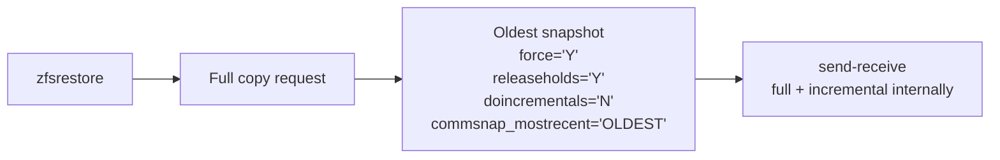

**Why two steps?** This restores the complete snapshot history, not just the latest state.

#### Destination hold preservation

A send stream carries no holds, so a full copy by itself would lose every hold tag on the destination snapshots. [`zfs-send-receive`](../commands-and-modules/modules.md#zfs-send-receive) preserves them on every full copy (`doincrementals='N'` or `force='Y'`) unless `preserve_target_holds='N'` or dry-run is set:

- **Capture** — before any dataset is touched, all holds under the destination are written to a temporary file. A failed capture aborts the run before any transfer.
- **Preparation** — destination preparation releases only `offsite-*` receipt holds, so the old snapshots can be destroyed. Holds with other tags are never released; they block the destruction, and a blocked preparation aborts the run.
- **Reapply** — after the transfer completes, the captured tags are applied to the restored snapshots. A tag already present counts as success. A captured snapshot missing from the restored lineage is skipped with a WARN.
- **Not covered** — plain incremental runs (nothing is destroyed), dry-run, `preserve_target_holds='N'`, and fatal exits mid-run. A fatal exit skips the reapply and leaves the capture file for manual `zfsreapplyholds --apply`.

The end-user view of this behavior is [Preserving Target Holds During a Restore](../user-guide/restore.md#preserving-target-holds-during-a-restore); the parameter is documented in [Global Variables](global-variables.md).

Restore scope and follow-up:

- **Dataset selection** is controlled by `$depth` via `zfsbuildfsarray`. The GUI defaults to `depth='0'` (restore only the named dataset) unless **Restore entire subtree (recursive)** is enabled; the command-line scripts default to `depth=''` (full subtree). An explicit `$depth` set by the caller always takes precedence.
- **After the send-receive**, `ensure-restored-vm-iscsi` re-exports any restored
  VM disk zvols that are referenced by a Proxmox VM config but have no active
  iSCSI LUN. This handles restores to a missing/detached disk while preserving the
  LUN index recorded in the VM config.

### Offsite Backup Flow

[`zfssendoffsite`](../commands-and-modules/commands.md#zfssendoffsite) copies data through a multi-step chain before applying ZFS holds that act as offline-safe receipts. This is an example and must be customized to your environment.

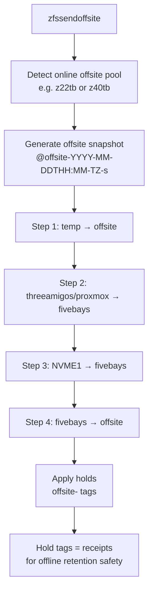

#### Hold tags as receipts

After each step succeeds, `applyholds` places a ZFS hold on both the source and destination snapshots:

| Location                   | Hold tag           | Meaning                    |
| -------------------------- | ------------------ | -------------------------- |
| `fivebays/...@offsite-...` | `offsite-z22tb`    | z22tb has this snapshot    |
| `z22tb/...@offsite-...`    | `offsite-fivebays` | fivebays has this snapshot |

These holds are used by [`zfscheckagainst`](../commands-and-modules/modules.md#zfscheckagainst) when the offsite pool is offline. If another `@offsite` snapshot on the same source carries the hold tag `offsite-<counterpart_pool>`, the counterpart definitely received that snapshot too — confirming that a second common snapshot exists and the current one is safe to delete.

## Deployment

This view answers: which node does each piece run on in the two-node
infrastructure? Names are roles; the
[Node Configuration](two-node-config.md) page maps them to real hosts.

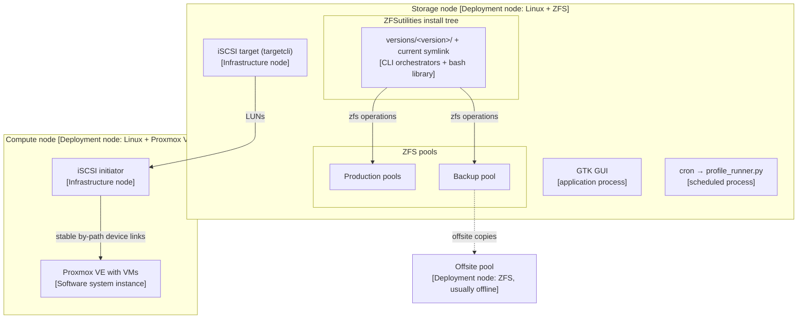

The GUI and the cron-launched profile runner both execute from the versioned
install tree, so an upgrade swaps every entry point at once. VM disks travel
as zvols: the storage node exports them over iSCSI, and the compute node
addresses them through stable `/dev/disk/by-path` links.
[Versioned Deployment](#versioned-deployment) explains the tree and its
symlinks; [Two-Node iSCSI Teardown/Rebuild](#two-node-iscsi-teardownrebuild)
explains how the LUNs survive destructive operations.

### Versioned Deployment

Scripts are installed to `/usr/local/lib/zfsutilities/versions/<version>/` and activated
via symlinks. This allows instant rollback and co-existence of multiple versions.

```
/usr/local/lib/zfsutilities/versions/v1.2.0/bin/   # scripts for v1.2.0
/usr/local/lib/zfsutilities/versions/v1.2.0/lib/   # libraries for v1.2.0
/usr/local/lib/zfsutilities/current -> versions/v1.2.0
/usr/local/lib/zfsutilities/bin -> current/bin      # on PATH
/root/bashinit -> current/bin/bashinit              # tracks active version
```

- **`deploy-version`** — copies the current repo into a new version directory without touching active production; records a `MANIFEST.sha256` of the installed files (the baseline `upgrade-zfsutilities` compares deployed trees against to detect local modifications)
- **`switch-version <version>`** — wires a deployed version into active production and atomically repoints the `current` symlink
- **`switch-version --uninstall`** — removes the production wiring installed by a version
- **`upgrade-zfsutilities`** — self-upgrade: fetches the latest GitHub release, scans every deployment target for files modified since installation (diffs shown, approval required, changes archived under `salvaged-changes/`), then deploys via deploy-version and stops — activation is left to the operator
- **`uninstall-version [-y|--yes] <version>`** — removes an old version directory; use `-y`/`--yes` to skip the confirmation prompt

`bin/` and `lib/` live inside each `versions/<version>/` directory because every
deployment must be a complete, self-contained installation. If executables were stored
directly under `/usr/local/lib/zfsutilities/bin/`, switching versions would require
copying or deleting files; with the symlink model, rollback is instantaneous and atomic.

### Two-Node iSCSI Teardown/Rebuild

In two-node mode, ZFS volumes (zvols) are exposed as iSCSI LUNs to the compute node. When a full copy destroys and recreates a destination dataset, the iSCSI backstore and LUN must be removed before `zfs destroy` and restored after `zfs receive` so that the compute node's by-path symlinks remain stable.

When a restore recreates a VM disk zvol with no active iSCSI LUN (for
example, a detached disk or a missing destination), the restore
pipeline calls `ensure-restored-vm-iscsi` to create the backstore and LUN mapping
using the same LUN index already recorded in the Proxmox VM config, then rescans the
compute host.  EFI disks are detected by their 4 MiB size and matched against the
`efidisk0:` config entry regardless of the zvol's disk number, since Proxmox EFI
zvols are not keyed to a specific disk index.

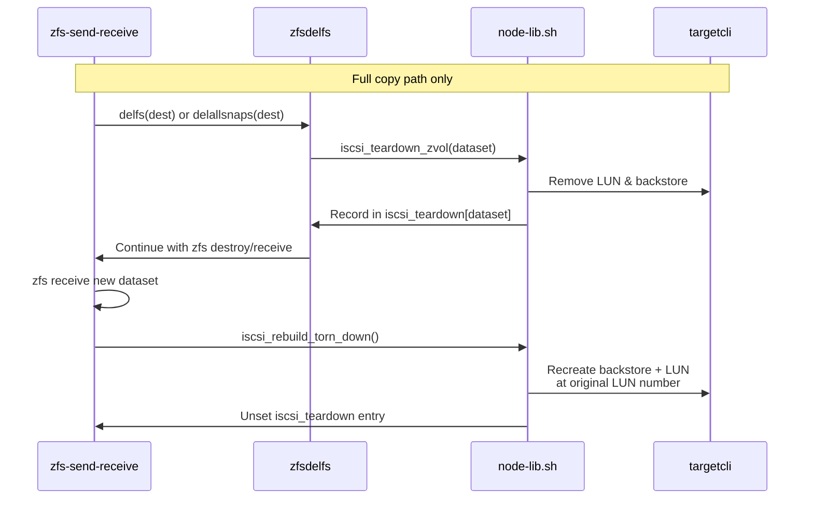

The `iscsi_teardown` associative array (see [Data Structures](data-structures.md#iscsi_teardown-associative-array)) bridges the teardown and rebuild across the destroy/receive cycle. In single-node mode this array is always empty and the helpers are no-ops.

## Error Handling & Resilience

Several mechanisms work together to make transfers safe and recoverable.

### Resume tokens

Interrupting a large `zfs receive` leaves a resume token on the destination. The next run:

1. Reads `receive_resume_token` from the destination dataset.
2. Validates it with `zfs send -nP -t <token>`.
3. If valid, resumes mid-stream. The remaining byte count is shown to the user.
4. If stale, aborts the token (`zfs receive -A`) and restarts the dataset loop.

Resumable receives are enabled when `$receive_s_option='s'` and the transfer size exceeds `$resumablethreshold` (default 50 GB).

### GUID verification

When `$verify_after_transfer='Y'`, the script compares the `guid` ZFS property of the source snapshot against the destination snapshot after receive. A mismatch is treated as fatal — it indicates corruption or a logic bug.

### Automatic diagnostics

Whenever a `zfs destroy` fails, [`zfs-diagnose-busy`](../commands-and-modules/modules.md#zfs-diagnose-busy) is automatically invoked. It reports the specific cause (clone dependents, holds, open files, active sends/receives, iSCSI LUNs, shares, etc.) and suggests the fix.

### Dry-run gate

`$dryrun='Y'` gates every destructive operation. In dry-run mode the script logs what it *would* do but skips snapshot creation, transfers, hold application, dataset destruction, and retention pruning. This is useful for verifying configuration and estimating transfer sizes.
